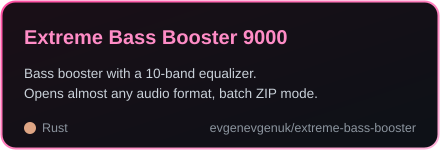
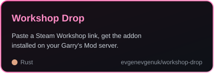
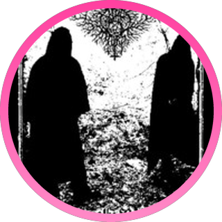
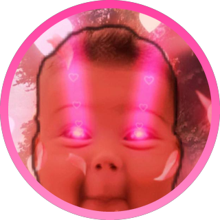

  

  

  

<h3 align="center">About me</h3>

  Garry's Mod addon maker and owner of the <b>Facts Sandbox</b> server. 
  I make TikToks about sandbox and write small desktop tools in Rust. 
  Everything I touch slowly turns pink.

  
  
  
  
  

<h3 align="center">Projects</h3>

  
  

<h3 align="center">My socials</h3>

<table align="center">
  <tr>
    <td align="center" width="170">
      <a href="https://steamcommunity.com/profiles/76561199641030581/">
         
        
      </a>
    </td>
    <td align="center" width="170">
      <a href="https://discord.gg/Y7udZbE39D">
         
        
      </a>
    </td>
    <td align="center" width="170">
      <a href="https://www.tiktok.com/@midex_facti">
         
        
      </a>
    </td>
    <td align="center" width="170">
      <a href="https://t.me/Midex_facti">
         
        
      </a>
    </td>
  </tr>
</table>

  

